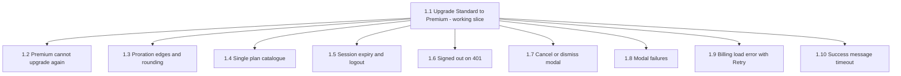

# aire State Tracking

## Project Information
- **Project Type**: Brownfield
- **Start Date**: 2026-10-23T07:53:23Z
- **Current Stage**: Design complete — awaiting dev-implement
- **Workflow Type**: epic
- **AIRE Framework Version**: 1.0

## Tracker
- Type: LOCAL
- Parent Epic: HELIX-6852 — Self-Serve Premium Upgrade (Atlas document 6852, sourced via Helix MCP)
- Epic URL: —
- Project Key / Repo / Org: —

## Workspace State
- **Existing Code**: Yes
- **Programming Languages**: Python (FastAPI backend), JavaScript/JSX (React 19 frontend)
- **Build System**: pip (requirements.txt) for backend; npm + Vite 8 for frontend
- **Project Structure**: Monolith (single-file FastAPI backend + React SPA)
- **Reverse Engineering Needed**: No (Atlas deep dive pulled)
- **Reverse Engineering Artifacts**: spec/plans/atlas-deep-dive.md
- **Workspace Root**: C:\Users\shailendra.yadav\Desktop\projects\billing cycle copy-A\billing-cycle-copy

## Code Location Rules
- **Application Code**: src/ (already the code root — no `## Code Root` override needed)
- **Documentation**: spec/ only
- **Structure patterns**: See code-generation.md Critical Rules

## Helix MCP Binding
- **Server**: helix
- **Docs tool(s)**: list_solution_documents_tool, get_solution_document_tool — list and fetch Atlas solution documents (Epic, Story, Deep Dive)
- **Graph/Search tool(s)**: codebase_agent_query, codebase_cypher_query, document_chatbot_query — targeted inline answers about the indexed codebase/docs
- **Estate / workspace id**: solution 951 "Billing-Cycle-Helix-Workshop" (repo Billing-Cycle, main @ 69f67f308492a85648aa25a9ff7d8d574031344a)
- **Resolved**: 2026-10-23T07:54:25Z

## Existing-System Context
- **Workspace type**: brownfield
- **Helix MCP**: connected
- **Source**: atlas
- **Components in scope**: src/backend/main.py, src/frontend/src/pages/Billing.jsx, src/frontend/src/context/AuthContext.jsx, src/frontend/src/App.css
- **Atlas deep dive doc**: spec/plans/atlas-deep-dive.md
- **Recorded**: 2026-10-23T07:54:25Z

## Atlas Artifact Sync
- Enabled: No
- Source: user opt-out

## Context Project
- **Existing Knowledge**: No
- **Existing Knowledge Path(s)**: —
- **New References**: No
- **New Reference Path(s)**: —

## Design References
| Reference | Type | Path | Read? | Read At Stage |
|---|---|---|---|---|
| (none registered) | — | — | — | — |

## Extension Configuration
| Extension | Enabled | Decided At |
|---|---|---|
| Security Baseline | Yes (always enforced) | Workflow start |
| UI/UX Mockups | No | Requirements Analysis |
| Resiliency Baseline | No | Requirements Analysis |
| Property-Based Testing | No | Requirements Analysis |
| Playwright Test Automation | Standalone only (/playwright-implement) | — |

## UI/UX Design
- **Mode**: skip
- **Provided design path(s)**: —
- **Decided At**: Requirements Analysis

## Branching
- Base Branch: main
- Epic Branch: epic/6852-self-serve-premium-upgrade
- Epic PR: (not raised — raised manually at cycle end via pr-generator)

## Story Planning
- team_size: 2
- story_creation_mode: all-at-once
- target_story_count: 10
- breakdown_approach: walking skeleton + increments (user direction)

## CI/CD Configuration
- Enabled: No
- Source: user opt-out

## Architecture
- **Document**: spec/plans/architecture.md v1.0.0
- **Rubrics**: tests/.evals/rubrics/architecture-rubric.json v1.0.0 (6 criteria), tests/.evals/rubrics/security-rubric.json v1.0.0 (7 criteria)
- **Eval config**: tests/.evals/config.json (created this cycle)

## Behaviour Specs & Test Plans
- **Work units covered**: 10
- **Behaviour contracts**: spec/behavior/ — 10 file(s), 47 scenarios (+ spec/behavior.feature, 3 cross-story journeys)
- **Manual test plans**: spec/test-plans/ — 10 folder(s), 129 test cases
- **AC coverage**: 39/39 (scenarios) · 39/39 (test cases)
- **Approved**: 2026-10-23T08:43:33Z

## Requirements Coverage (post-design)
- Requirements coverage verified post-design: 23/23 REQ-IDs — 2026-10-23T08:43:33Z (functional-design.md and architecture.md reconciled; no story AC contradicted by the design, no reconciliation needed)

## Story Tracker
| Story | Title | Requires | Tracker ID | Status | PR | Merged | Start | End | Recorded |
|-------|-------|----------|------------|--------|----|--------|-------|-----|----------|
| 1.1 | Upgrade from Standard to Premium on the Billing page | none | LOCAL | Ready for Development | — | — | | | 2026-10-23T08:23:45Z |
| 1.2 | Premium users cannot preview or upgrade again | 1.1 | LOCAL | Ready for Development | — | — | | | 2026-10-23T08:23:45Z |
| 1.3 | Proration boundary and rounding rules | 1.1 | LOCAL | Ready for Development | — | — | | | 2026-10-23T08:23:45Z |
| 1.4 | Seed and registration use the single plan catalogue | 1.1 | LOCAL | Ready for Development | — | — | | | 2026-10-23T08:23:45Z |
| 1.5 | Sessions expire and logout ends the session | 1.1 | LOCAL | Ready for Development | — | — | | | 2026-10-23T08:23:45Z |
| 1.6 | Signed out on an invalid or expired session | 1.1 | LOCAL | Ready for Development | — | — | | | 2026-10-23T08:23:45Z |
| 1.7 | Cancel or dismiss the upgrade modal without upgrading | 1.1 | LOCAL | Ready for Development | — | — | | | 2026-10-23T08:23:45Z |
| 1.8 | Upgrade modal shows preview and upgrade failures | 1.1 | LOCAL | Ready for Development | — | — | | | 2026-10-23T08:23:45Z |
| 1.9 | Billing page shows a load error with Retry | 1.1 | LOCAL | Ready for Development | — | — | | | 2026-10-23T08:23:45Z |
| 1.10 | Upgrade success message times out and can be dismissed | 1.1 | LOCAL | Ready for Development | — | — | | | 2026-10-23T08:23:45Z |

## Dependency Graph
Generated: 2026-10-23T08:23:45Z (auto-generated, no approval gate) — spec/plans/dependency-graph.yml

**Ready now**: 1.1 only (seed story — user-directed working slice).
**Blocked on 1.1**: 1.2-1.10; all 9 become startable in parallel once 1.1 is merged (no edges among them).
**Parallelism note**: only 1 story is startable at first (below team_size 2) — accepted consequence of the user's direction that Story 1 delivers the working UI; R1 seed rule applies (1.1 creates the session store, endpoints, modal, PLANS catalogue and test tooling that every other story edits).

Inferred edges:
- 1.2 requires 1.1 — needs the preview and upgrade endpoints and the Billing upgrade button created by 1.1 to exist at run time
- 1.3 requires 1.1 — refines the proration function that 1.1 creates in main.py
- 1.4 requires 1.1 — consolidates seed/register onto the PLANS catalogue that 1.1 introduces (with the Premium entry)
- 1.5 requires 1.1 — extends the in-memory session store and Bearer validation created by 1.1
- 1.6 requires 1.1 — reacts to 401s from the Bearer-authenticated fetches that 1.1 adds to AuthContext.jsx and Billing.jsx
- 1.7 requires 1.1 — adds dismiss paths and focus handling to the upgrade modal component created by 1.1
- 1.8 requires 1.1 — adds failure handling to the preview/upgrade calls in the modal created by 1.1
- 1.9 requires 1.1 — changes the Billing.jsx billing fetch that 1.1 rewrites for the Bearer token (seed rule R1: avoids an unmergeable conflict in Billing.jsx)
- 1.10 requires 1.1 — refines the success message that 1.1 introduces

## Stage Progress
- [x] Workspace Detection — state check, tracker selection (LOCAL), Epic + Deep Dive pulled from Atlas, epic branch created
- [x] Workspace Detection — Atlas Artifact Sync opt-in (No), Context opt-in (No/No)
- [-] Reverse Engineering — SKIPPED (Atlas deep dive found and pulled)
- [x] Requirements Analysis — Standard depth; spec/plans/requirements.md v1 approved (16 REQ-F, 7 REQ-NF)
- [x] User Stories — 10 stories approved at GATE 1; LOCAL tracker (no push)
- [x] Dependency Graph — spec/plans/dependency-graph.yml (1.1 seed; 1.2-1.10 require 1.1)
- [x] Workflow Planning — spec/plans/executions.md (auto-approved)
- [-] Application Design — SKIP (work inside existing components; contracts fixed in requirements.md)

### IMPLEMENTATION PHASE
- [x] Functional Design — spec/plans/functional-design.md v1 approved
- [-] NFR Requirements — SKIP (stack fixed; NFRs specified in requirements.md)
- [-] NFR Design — SKIP (NFR Requirements skipped; patterns covered in Functional Design)
- [-] Infrastructure Design — SKIP (no infrastructure change)
- [x] Behaviour Specs & Test Plans — 10/10 stories, approved
- [ ] Code Generation — EXECUTE (per story via dev-implement)
