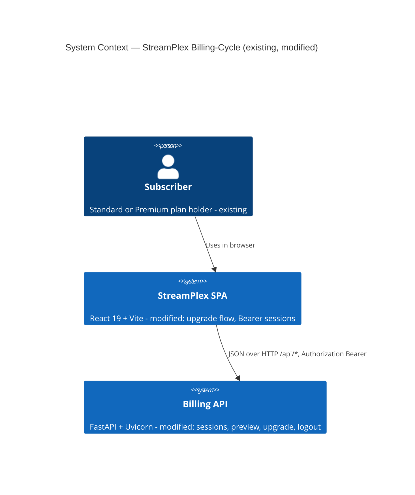
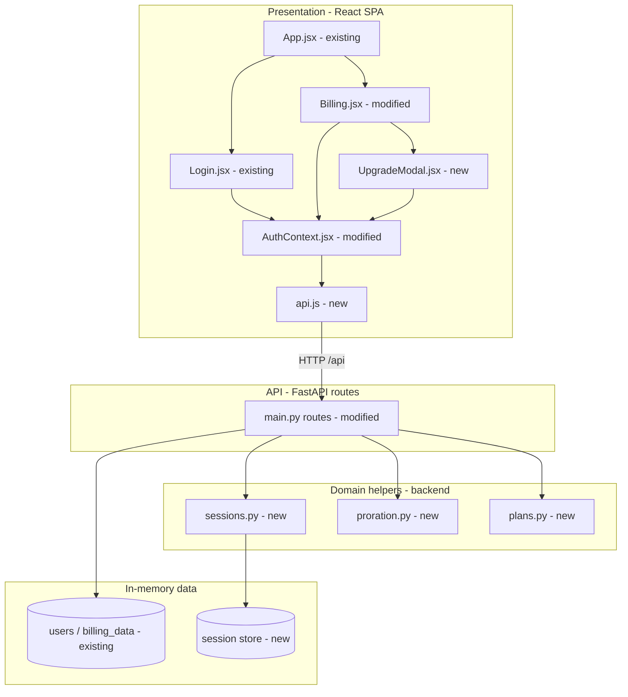
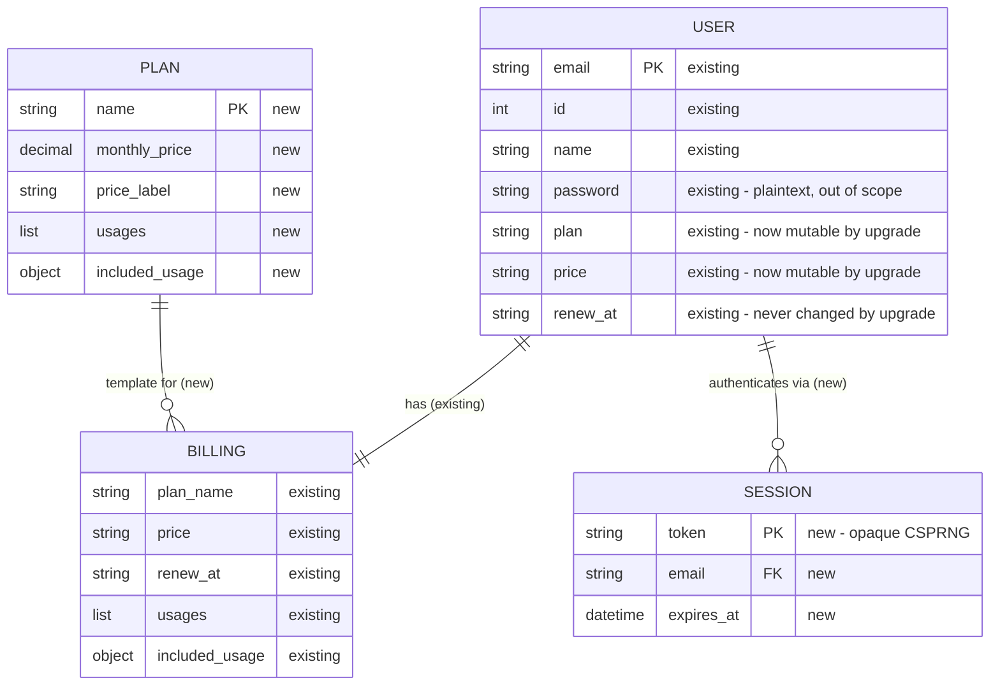
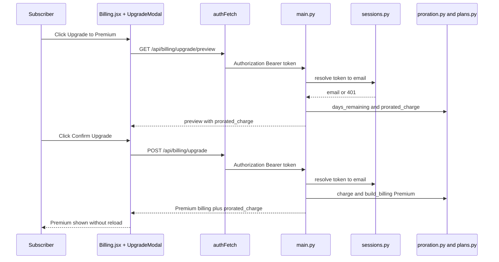

# Architecture — Billing-Cycle (StreamPlex)

> **Version**: 1.0.0 · **Generated**: 2026-10-23T08:33:05Z · **AIRE**: v1.0
> **Derived from**: spec/plans/atlas-deep-dive.md (Atlas), spec/plans/functional-design.md v1,
> spec/plans/requirements.md v1, spec/plans/executions.md. NFR Requirements, NFR Design, Infrastructure
> Design and Application Design were SKIPPED (see Sections 6–8 for the defaults that apply instead).
> No Design References registered.
> **Existing-system baseline**: Atlas via Helix MCP — solution 951 "Billing-Cycle-Helix-Workshop",
> Deep Dive v29 (repo Billing-Cycle @ 69f67f308492a85648aa25a9ff7d8d574031344a)

## 1. System Context

StreamPlex Billing-Cycle is a proof-of-concept subscription billing dashboard. A subscriber uses the React
SPA in a browser; the SPA calls the FastAPI backend under `/api/*` (through the Vite proxy in development, or
same-origin when FastAPI serves the built SPA). The backend has no database and calls no external systems.
This cycle adds the self-serve Standard → Premium upgrade and replaces the email-as-token scheme with
server-side sessions.

Text alternative: the Subscriber (existing) uses the StreamPlex SPA (modified), which calls the Billing API
(modified) with JSON over HTTP and a Bearer session token. There are no external systems.

## 2. Component Inventory

| Component | Responsibility | Status | Source |
|---|---|---|---|
| `src/backend/main.py` | FastAPI app, CORS, request models, routes, static mount | existing (modified) | Atlas deep dive; functional-design.md Section 1.1, 4 |
| `src/backend/plans.py` | `PLANS` catalogue; `build_billing()` deep copies | new | functional-design.md Section 1.1, 2.1 |
| `src/backend/proration.py` | Pure `days_remaining()` and `prorated_charge()` | new | functional-design.md BR-1, BR-2 |
| `src/backend/sessions.py` | In-memory session store; `get_current_email` dependency | new | functional-design.md BR-5, BR-6 |
| In-memory stores `users`, `billing_data` | User and billing records keyed by email | existing (modified usage) | Atlas deep dive; functional-design.md Section 2 |
| `src/frontend/src/api.js` | `authFetch` — Bearer header, 401 hook, error mapping | new | functional-design.md Section 1.2 |
| `src/frontend/src/context/AuthContext.jsx` | Session state, login/register/logout, bound `authFetch` | existing (modified) | Atlas deep dive; functional-design.md 5.4 |
| `src/frontend/src/pages/Billing.jsx` | Billing view, upgrade button, success message, load error | existing (modified) | Atlas deep dive; functional-design.md 5.2 |
| `src/frontend/src/components/UpgradeModal.jsx` | Preview and confirm dialog | new | functional-design.md 5.3 |
| `src/frontend/src/App.jsx`, `pages/Login.jsx` | Routing, layout, login form | existing (unchanged) | Atlas deep dive |

Text alternative: in the SPA, App routes to Login and Billing; Billing renders UpgradeModal; Login, Billing and
UpgradeModal use AuthContext, which calls the API through api.js. In the backend, main.py routes use
sessions.py, proration.py and plans.py and read/write the users and billing_data stores; sessions.py owns the
session store.

## 3. Layering and Boundaries

- **Frontend**: components never call `fetch` directly for `/api/*`; every API call goes through `authFetch`
  (via `useAuth()`), which is the only place the `Authorization` header is set and the only place a 401 is
  turned into a sign-out. Components never compute money or dates — they display server values.
- **Backend**: `proration.py` and `plans.py` are pure (no FastAPI, no global store access). `sessions.py` owns
  the session store; no other module reads or writes it directly. Routes in `main.py` obtain the acting user
  only through the `get_current_email` dependency, never from a query parameter or body field.
- Forbidden: route handlers reading `email` from the request for identity; any module other than
  `plans.py` defining plan feature data; any component other than `UpgradeModal` / `Billing` calling the
  upgrade endpoints.

## 4. Data Architecture

All data is in-memory (Python dicts / one store object) and resets on restart — persistence is out of scope.
Ownership: `main.py` owns `users` and `billing_data`; `sessions.py` owns sessions; `plans.py` owns the
read-only catalogue. The upgrade is a single in-process sequence (no awaits between read and write), so no
transaction mechanism is needed.

Text alternative: USER (existing) has one BILLING record (existing) and zero or more SESSIONs (new); each
BILLING record is built from one PLAN in the new catalogue.

## 5. API and Integration Contracts

REST/JSON, unversioned (single SPA client). Errors: `{"detail": "<message>"}`. Auth: `Authorization: Bearer
<opaque token>` on every protected route; missing/invalid/expired → 401 `Not authenticated`. Full contracts in
`spec/plans/functional-design.md` Section 4.

| Endpoint | Status | Auth |
|---|---|---|
| `POST /api/auth/login` | modified (opaque token) | public |
| `POST /api/auth/register` | modified (opaque token, catalogue) | public |
| `POST /api/auth/logout` | new (story 1.5) | Bearer |
| `GET /api/users/me` | modified (Bearer, no `email` param) | Bearer |
| `GET /api/billing` | modified (Bearer, no fallback) | Bearer |
| `GET /api/billing/upgrade/preview` | new | Bearer |
| `POST /api/billing/upgrade` | new | Bearer |

Text alternative: the subscriber opens the modal, which requests the preview through authFetch; main.py
resolves the session, computes the charge and returns it. On Confirm, the upgrade request is authenticated the
same way, main.py computes the charge, switches the user's billing to the Premium catalogue entry and returns
it, and the page updates without a reload.

## 6. Cross-Cutting Decisions

- **AuthN/AuthZ**: opaque server-side sessions (`secrets.token_urlsafe(32)`), TTL `SESSION_TTL_HOURS` (default
  8), new session per login, revoked on logout. Identity only from the session (functional-design BR-6).
  Password hashing and brute-force protection are pre-existing gaps, out of scope (requirements Section 5).
- **CORS**: allowlist from `CORS_ALLOWED_ORIGINS` (default localhost:5173 / 127.0.0.1:5173), never `*`,
  `allow_credentials=False`, methods GET/POST, headers Authorization/Content-Type.
- **Input validation**: Pydantic models with max lengths and an email pattern.
- **Error handling**: `{"detail"}` errors; generic 500 handler without internals; frontend maps 401 → sign-out,
  others → message.
- **Logging**: Python `logging` at INFO for upgrade, logout and session-expiry events with `user_id` only —
  never token, email or password.
- **Configuration**: environment variables only; no secrets in code.
- **Concurrency/idempotency**: single-process, synchronous handlers; a repeated upgrade is rejected with 400
  (BR-3), so the operation is safe to retry. Resilience patterns: N/A (Resiliency Baseline disabled; no
  external calls).
- **NFR Design stage**: SKIPPED — the above patterns come from functional-design.md.

## 7. Non-Functional Targets

| Concern | Target | Source | How it is verified |
|---|---|---|---|
| Security | Security Baseline compliant for changed code; 0 J2 vulnerabilities | REQ-NF-01 | Code Review + J2 |
| Usability | Upgrade completed in under 60 s | REQ-NF-02 | Manual test plan (timed) |
| Latency | Preview and upgrade under 500 ms locally | REQ-NF-02 | API test timing |
| Accessibility | Dialog semantics, focus management, announced messages | REQ-NF-03 | Frontend tests + manual test plan |
| Test coverage | Changed-file coverage ≥ `unitTestCoverageMin` | REQ-NF-04, tests/.evals/config.json | Coverage gate |
| Dependencies | No new runtime packages | REQ-NF-05 | Diff of requirements.txt / package.json `dependencies` |

NFR Requirements stage: SKIPPED — targets come from requirements.md.

## 8. Infrastructure and Deployment

Unchanged (Infrastructure Design SKIPPED): one Uvicorn process serves the API and, when `src/frontend/dist`
exists, the built SPA on the same origin; in development the Vite dev server (port 5173) proxies `/api` to
`localhost:8000`. No cloud resources, containers or databases. New optional environment variables:
`SESSION_TTL_HOURS`, `CORS_ALLOWED_ORIGINS`. Test-only tooling: `src/backend/requirements-dev.txt`
(pytest, httpx, pytest-cov) and frontend devDependencies (vitest, @testing-library/react, jsdom).

## 9. Delta from the Existing System

| Area | Before (Atlas) | After | Reason |
|---|---|---|---|
| Auth token | `access_token` = user's email, sent as `?email=` | Opaque CSPRNG session token, `Authorization: Bearer` | REQ-F-01/02, SECURITY-08/12 |
| Sessions | None (no expiry, no server logout) | In-memory store with TTL and `POST /api/auth/logout` | REQ-F-03 |
| CORS | `allow_origins=["*"]` + credentials | Env-configured allowlist, no credentials | REQ-NF-01, SECURITY-08 |
| Billing page | Read-only, hardcoded "Standard" labels, silent fetch errors | Upgrade button + modal, dynamic labels, success/error states | REQ-F-10..15 |
| Plan data | Standard block duplicated in seed and register | Single `PLANS` catalogue (Standard + Premium) | REQ-F-05, REQ-NF-07 |
| `GET /api/billing` | Falls back to the demo user's data | Returns only the caller's own data | SECURITY-08 |
| Backend structure | One file `main.py` | `main.py` + `plans.py`, `proration.py`, `sessions.py` | Functional design Q1 |
| Tests | None | pytest + vitest suites under `tests/` | REQ-NF-04 |

## 10. Verifiable Constraints

### ARCH-01 — Identity comes only from the server-side session
- **Constraint**: Every protected route resolves the acting user through the `get_current_email` session dependency and never from a request-supplied email.
- **Verifiable as**: In the diff, every route handler for `/api/users/me`, `/api/billing*` and `/api/auth/logout` must take the session dependency and must not read an `email` query parameter or body field to choose whose data is read or changed. Score 0 if any changed protected handler selects a user from request input or lacks the dependency.
- **Weight**: 0.25
- **Source**: spec/plans/functional-design.md (BR-6, Section 4)

### ARCH-02 — Money is computed once, on the server, with Decimal
- **Constraint**: The prorated charge is computed only by `proration.prorated_charge` using `Decimal` with `ROUND_HALF_UP`, and both the preview and the upgrade route call it.
- **Verifiable as**: Score 0 if the diff computes a charge with `float` arithmetic or Python `round()`, duplicates the formula in another backend module, or computes the charge or days remaining in frontend code (frontend may only format the server value).
- **Weight**: 0.20
- **Source**: spec/plans/functional-design.md (BR-1, BR-2), requirements.md REQ-NF-06

### ARCH-03 — Plan data is defined once in the catalogue
- **Constraint**: Plan prices and feature data come only from `plans.PLANS` via `build_billing()` deep copies.
- **Verifiable as**: Score 0 if the diff adds a literal plan feature block, price label or monthly price for Standard or Premium anywhere outside `plans.py`, or assigns a catalogue entry to a user without copying it.
- **Weight**: 0.15
- **Source**: spec/plans/functional-design.md (Section 2.1), requirements.md REQ-F-05

### ARCH-04 — Frontend API calls go through authFetch
- **Constraint**: All frontend calls to protected `/api/*` endpoints go through `authFetch`, which alone sets the Bearer header and handles 401.
- **Verifiable as**: Score 0 if a changed component or context calls `fetch` directly for a protected endpoint, builds an `Authorization` header itself, or puts the token in a URL query string.
- **Weight**: 0.15
- **Source**: spec/plans/functional-design.md (Section 1.2, 5.4)

### ARCH-05 — Pure domain helpers stay pure
- **Constraint**: `proration.py` and `plans.py` contain no FastAPI imports, no access to `users`, `billing_data` or the session store, and `proration.py` takes "today" as a parameter.
- **Verifiable as**: Score 0 if the diff adds a FastAPI/Starlette import, a reference to the global stores or session store, or a direct `date.today()`/`datetime.now()` call inside `proration.prorated_charge`/`days_remaining` without an injectable date parameter.
- **Weight**: 0.10
- **Source**: spec/plans/functional-design.md (Section 1.1, BR-1)

### ARCH-06 — No secrets or personal data in logs or error responses
- **Constraint**: Log statements and error responses never include session tokens, passwords or email addresses.
- **Verifiable as**: Score 0 if any changed log call or `HTTPException`/error payload includes a token, password, email or a whole user/request object, or if an error response includes a stack trace or exception text.
- **Weight**: 0.15
- **Source**: spec/plans/functional-design.md (BR-4, BR-5, Section 6), architecture.md Section 6

Weights: 0.25 + 0.20 + 0.15 + 0.15 + 0.10 + 0.15 = 1.00

## 11. Explicitly Out of Scope

- Persistent storage, databases, migrations; session persistence across restarts
- Downgrades, refunds/credits, payments, payment SDKs, invoices, billing history
- Plans other than Standard and Premium
- Password hashing, brute-force protection, MFA, removal of pre-filled demo credentials (pre-existing gaps)
- JWTs, cookies, OAuth/SSO
- Horizontal scaling, containers, cloud infrastructure, CI pipeline (user opted out)
- A frontend state library or new runtime dependencies
