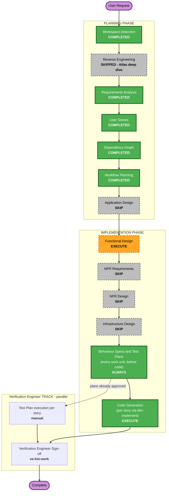

# Execution Plan — Epic HELIX-6852 Self-Serve Premium Upgrade

## Detailed Analysis Summary

### Transformation Scope (Brownfield)
- **Transformation Type**: Single application, application-level change (no architectural or infrastructure transformation)
- **Primary Changes**: New preview/upgrade endpoints, proration rule, plan catalogue and server-side sessions in the FastAPI backend; upgrade button, modal, success/error states on the React Billing page; Bearer token use in `AuthContext.jsx`
- **Related Components**: `src/backend/main.py`, `src/frontend/src/pages/Billing.jsx`, `src/frontend/src/context/AuthContext.jsx`, `src/frontend/src/App.css`, `src/frontend/package.json` (dev deps only), new `tests/`

### Change Impact Assessment
- **User-facing changes**: Yes — upgrade button, confirmation modal, success and error messages on the Billing page; login/registration unchanged from the user's view
- **Structural changes**: Minor — new backend helpers (session store, plan catalogue, proration) and a new frontend modal component; same single-process deployment
- **Data model changes**: Yes (in-memory only) — new session store; `PLANS` catalogue; `users`/`billing_data` mutated on upgrade. No database (out of scope)
- **API changes**: Yes — new `GET /api/billing/upgrade/preview`, `POST /api/billing/upgrade`, `POST /api/auth/logout`; `access_token` becomes opaque; `/api/users/me` and `/api/billing` read identity from `Authorization: Bearer` instead of `?email=` (breaking for any other client — none exist besides this SPA)
- **NFR impact**: Yes — security (sessions, CORS, validation), accessibility (modal), testability (new test tooling)

### Component Relationships
- **Primary Component**: FastAPI backend (`src/backend/main.py`) — Major change
- **Dependent Component**: React SPA (`AuthContext.jsx`, `Billing.jsx`) — Major change (consumes the changed auth contract and new endpoints)
- **Shared Components**: none (no shared libraries)
- **Supporting Components**: Vite dev proxy (`vite.config.js`) — no change; new `tests/` tree and test-only dependencies
- **Infrastructure Components**: none

### Risk Assessment
- **Risk Level**: Medium — the auth contract change touches every protected call; mitigated by Story 1.1 AC-5 regression ACs and tests
- **Rollback Complexity**: Easy — revert the story PRs on the epic branch; no data migration (in-memory)
- **Testing Complexity**: Moderate — date-dependent proration (tests freeze "today"), modal interaction tests

## Workflow Visualization

Text alternative: Planning is complete (Workspace Detection, Requirements Analysis, User Stories,
Dependency Graph, Workflow Planning; Reverse Engineering skipped because the Atlas deep dive was pulled;
Application Design skipped). Implementation runs Functional Design, skips NFR Requirements, NFR Design and
Infrastructure Design, then always runs Behaviour Specs and Test Plans at the STOP checkpoint, then per-story
Code Generation via `dev-implement`. The Verification Engineer track runs in parallel.

## Phases to Execute

### PLANNING PHASE
- [x] Workspace Detection (COMPLETED)
- [x] Reverse Engineering (SKIPPED — Atlas deep dive pulled via Helix MCP)
- [x] Requirements Analysis (COMPLETED)
- [x] User Stories (COMPLETED)
- [x] Dependency Graph (COMPLETED)
- [x] Execution Plan (COMPLETED)
- [ ] Application Design - SKIP
  - **Rationale**: Work stays inside the two existing components (FastAPI app, React SPA); the new pieces (session store, plan catalogue, proration helper, upgrade modal) and their contracts are already fixed in `requirements.md` REQ-F-01..15. Their internal structure is designed in Functional Design.

### IMPLEMENTATION PHASE
- [ ] Functional Design - EXECUTE
  - **Rationale**: New business rules (proration, rounding, session lifecycle), new in-memory domain model (sessions, plan catalogue, mutation on upgrade), new API contracts, and a new UI state flow (modal, success, errors) need precise definition before code.
- [ ] NFR Requirements - SKIP
  - **Rationale**: Tech stack is fixed (FastAPI + React/Vite, no new runtime deps); NFRs are already specified and measurable in `requirements.md` REQ-NF-01..07, and the Security Baseline is enforced regardless.
- [ ] NFR Design - SKIP
  - **Rationale**: NFR Requirements skipped; the security/accessibility patterns needed (Bearer session, CORS allowlist, dialog focus management) are captured in Functional Design.
- [ ] Infrastructure Design - SKIP
  - **Rationale**: No infrastructure or deployment change — same single process, in-memory store, local dev proxy.
- [ ] Behaviour Specs & Test Plans - EXECUTE (ALWAYS, at the STOP CHECKPOINT, ONE approval)
  - **Rationale**: every work unit's `.feature` contract and manual test plan are written and approved before any code is generated (`implementation/specs-and-test-plans.md`)
- [ ] Code Generation - EXECUTE (ALWAYS)
  - **Rationale**: Implementation planning and code generation needed — per story via `dev-implement`

### Verification Engineer TRACK (parallel — Verification Engineer-initiated, NOT planned or executed by this workflow)
- Test Plan — authored for every work unit at the STOP CHECKPOINT; the Verification Engineer reviews it and executes it once the work unit's PR merges
- Verification Engineer Sign-off — `ve-list-work` on the epic branch once story PRs merge

## Package Change Sequence (Brownfield)
1. Story 1.1 (backend + frontend together — the working slice; seeds every shared file)
2. Stories 1.2–1.10 in parallel (no edges among them), per `spec/plans/dependency-graph.yml`

## Estimated Timeline
- **Total Phases**: 9 executed (6 planning done + Functional Design + Behaviour Specs/Test Plans + Code Generation)
- **Estimated Duration**: Story 1.1 about 1–2 days; stories 1.2–1.10 about 2–3 days with 2 developers in parallel

## Success Criteria
- **Primary Goal**: A Standard subscriber can upgrade to Premium from the Billing page, seeing the prorated charge first, in under 60 seconds
- **Key Deliverables**: Preview/upgrade/logout endpoints, opaque sessions, plan catalogue, Billing page upgrade flow, tests
- **Quality Gates**: Security Baseline (blocking), unit-test coverage threshold, API & contract tests for new endpoints, J1/J2 judge gates, automated Code Review
- **Integration Testing**: The cross-story journey in `spec/behavior.feature` (sign in → upgrade → Premium shown → logout)
- **Operational Readiness**: INFO logging of upgrade/logout events without secrets
