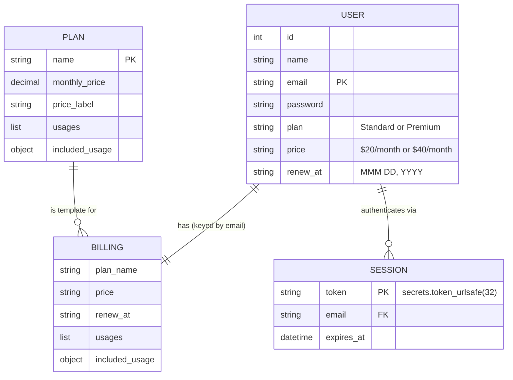
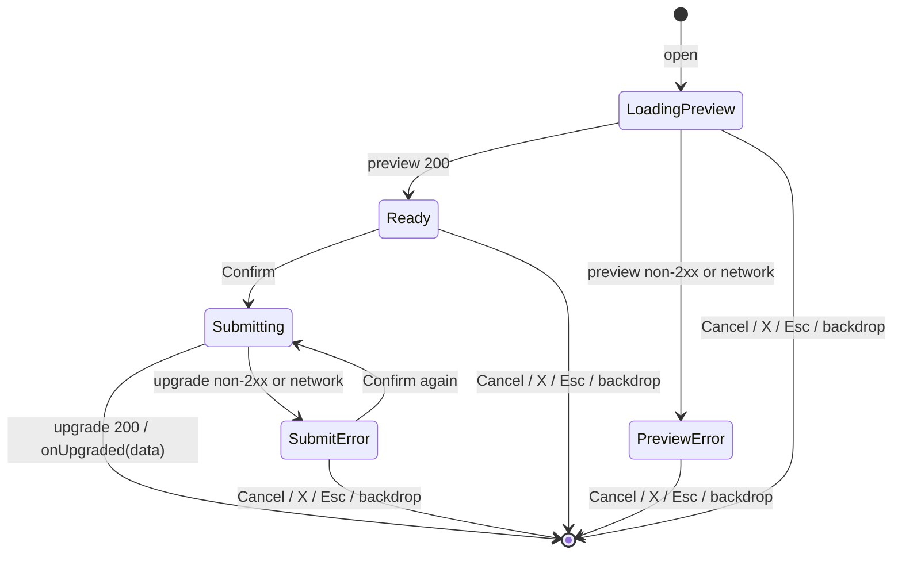

# Functional Design — Epic HELIX-6852 Self-Serve Premium Upgrade

**Version**: 1
**Generated**: 2026-10-23
**Inputs**: `spec/plans/epic-brief.md`, `spec/plans/requirements.md` v1, `spec/plans/stories.md` (1.1–1.10),
`spec/plans/atlas-deep-dive.md` (existing-system truth), answers in
`spec/spec-generation/functional-design-generation.md` (Q1–Q4 = A).
**Starting state (Atlas)**: single-file FastAPI backend with in-memory `users` / `billing_data` dicts keyed by
email; "token" = email; React SPA with `AuthContext` and a read-only `Billing.jsx`.

---

## 1. Module Structure

### 1.1 Backend (`src/backend/`) — Q1 = A

| Module | Responsibility | Depends on |
|---|---|---|
| `plans.py` | `PLANS` catalogue (Standard, Premium) and `build_billing(plan_name, renew_at)` returning a fresh deep copy | — |
| `proration.py` | Pure functions `days_remaining(renew_at, today)` and `prorated_charge(days_remaining)` | `decimal`, `datetime` (stdlib) |
| `sessions.py` | In-memory `SessionStore` (create, resolve, revoke, purge expired) and FastAPI dependency `get_current_email` | `secrets`, `datetime` (stdlib), `fastapi` |
| `main.py` | App, CORS, request models, routes, static mount (unchanged role) | the three modules above |

No new runtime packages (REQ-NF-05). Configuration via environment variables (Q3 = A):
- `SESSION_TTL_HOURS` — integer, default `8`; invalid or < 1 falls back to `8`.
- `CORS_ALLOWED_ORIGINS` — comma-separated, default `http://localhost:5173,http://127.0.0.1:5173`; `*` is
  never accepted (dropped if present).

### 1.2 Frontend (`src/frontend/src/`) — Q2 = A

| File | Responsibility |
|---|---|
| `api.js` (new) | `authFetch(path, { token, onUnauthorized, ...init })` — adds `Authorization: Bearer <token>`, JSON headers; on 401 calls `onUnauthorized()` and throws `UnauthorizedError`; on other non-2xx throws `ApiError(detail, status)` using the body's `detail` or the generic message |
| `context/AuthContext.jsx` (changed) | Stores the opaque token; uses `authFetch` for `/api/users/me`; exposes `authFetch` bound to the current token with `onUnauthorized = clear session + navigate('/login')`; `logout()` calls `POST /api/auth/logout` (best effort) then clears |
| `components/UpgradeModal.jsx` (new) | Dialog: loads preview, shows charge, Confirm/Cancel, in-flight and error states, focus management |
| `pages/Billing.jsx` (changed) | Loads billing via `authFetch`; loading / error-with-Retry / loaded states; dynamic plan labels; Upgrade button for Standard; renders `UpgradeModal`; applies the upgrade response; success message |
| `App.css` (changed) | Styles: `.upgrade-btn`, `.premium-badge`, `.modal-backdrop`, `.modal`, `.modal-actions`, `.alert-error`, `.alert-success` (follow existing `.btn`, `.standard-badge`, `.error-text` conventions) |

---

## 2. Domain Model (in-memory)



Text alternative: each user has exactly one billing record (keyed by email) and zero or more sessions; each
billing record is built from one plan in the catalogue.

### 2.1 Entities and invariants

- **PLAN** (`plans.PLANS`): `Standard` = monthly price `Decimal("20.00")`, label `"$20/month"`, usages and
  perks exactly as today's Standard block; `Premium` = `Decimal("40.00")`, `"$40/month"`, usages/perks exactly
  the "Premium Plan Feature Data" in `epic-brief.md`. `build_billing()` returns a deep copy so mutating one
  user's billing never alters the catalogue or another user.
- **USER** / **BILLING**: unchanged shape. Invariant: `users[e]["plan"] == billing_data[e]["plan_name"]` and
  both `renew_at` values are equal; upgrade changes plan and price on both and never changes `renew_at`.
- **SESSION**: `token` = `secrets.token_urlsafe(32)` (256 bits, opaque, no embedded data); `expires_at` =
  issue time (UTC) + `SESSION_TTL_HOURS`. A new session is created on every login/register (no reuse → no
  fixation). Multiple concurrent sessions per user are allowed.
- The existing fallback in `GET /api/billing` (`billing_data.get(email, billing_data["tpg@example.com"])`) is
  **removed**: it could return another user's data. A user always has a billing record (seed or register).

---

## 3. Business Rules

### BR-1 — Days remaining (REQ-F-06; Q4 = A)
`days_remaining(renew_at, today) = max(0, (parse(renew_at, "%b %d, %Y") - today).days)` where `today` is the
server's local date (`date.today()`), injectable for tests.

### BR-2 — Prorated charge (REQ-F-06, REQ-NF-06)
```
DAYS_IN_CYCLE = 30
diff  = Premium.monthly_price - Standard.monthly_price            # Decimal("20.00")
days  = min(days_remaining, 30)
charge = (diff * days / 30).quantize(Decimal("0.01"), ROUND_HALF_UP)
```
Examples: 0 → 0.00 · 1 → 0.67 · 7 → 4.67 · 15 → 10.00 · 29 → 19.33 · 30 → 20.00 · 45 → 20.00.
Returned in JSON as a number with 2 decimals (`float(charge)`); the frontend formats `$` + `toFixed(2)` only
for display — it never computes the charge.

### BR-3 — Upgrade eligibility (REQ-F-07, REQ-F-08)
Only a user whose `plan == "Standard"` may preview or upgrade. `Premium` → HTTP 400
`"Already on Premium plan"`, no state change.

### BR-4 — Upgrade effect (REQ-F-08, REQ-F-09)
Atomic in-process sequence for the session's user: check BR-3 → compute BR-1/BR-2 → `billing_data[e] =
build_billing("Premium", renew_at)` → `users[e].plan/price = Premium` → log INFO `upgrade user_id=<id>
charge=<charge>` (no email, token or password). `renew_at` is read from `billing_data[e]` and written back
unchanged.

### BR-5 — Session lifecycle (REQ-F-01..03)
- **Issue**: on successful login or register.
- **Validate**: every protected request — header must be exactly `Bearer <token>`; token must exist and
  `now < expires_at`; otherwise 401. Expired sessions are deleted when encountered.
- **Revoke**: `POST /api/auth/logout` deletes the presented session; INFO log `logout user_id=<id>`.
- **Expiry**: `SESSION_TTL_HOURS` (default 8).

### BR-6 — Identity (REQ-F-02, SECURITY-08)
The acting user is ALWAYS the session's email. `email` query parameters and any body fields are ignored for
identity; the upgrade endpoint takes no body fields (an empty or extra JSON body is accepted and ignored).

---

## 4. API Contracts

Common: JSON; errors are `{"detail": "<message>"}` with no stack traces (SECURITY-15). Protected endpoints
require `Authorization: Bearer <token>`; missing/malformed/unknown/expired → **401**
`{"detail": "Not authenticated"}`.

| Method & path | Auth | Request | 200 response | Errors |
|---|---|---|---|---|
| `POST /api/auth/login` (changed) | public | `{email (≤254, email format), password (1..128)}` | `{access_token: <opaque>, user: {id,name,email,plan,price,renew_at}}` | 401 Invalid credentials; 422 validation |
| `POST /api/auth/register` (changed) | public | `{name (1..100), email (≤254, email format), password (1..128)}` | same as login | 400 Account already exists; 422 |
| `POST /api/auth/logout` (new, 1.5) | Bearer | — | `{"detail": "Logged out"}` | 401 |
| `GET /api/users/me` (changed) | Bearer | — (no `email` param) | user without password | 401 |
| `GET /api/billing` (changed) | Bearer | — (no `email` param) | billing object (plan_name, price, renew_at, usages, included_usage) | 401 |
| `GET /api/billing/upgrade/preview` (new) | Bearer | — | `{current_plan, current_price, new_plan, new_price, days_remaining, days_in_cycle: 30, prorated_charge, renew_at}` | 400 Already on Premium plan; 401 |
| `POST /api/billing/upgrade` (new) | Bearer | empty / ignored | `{plan_name: "Premium", price: "$40/month", renew_at, prorated_charge, usages, included_usage}` | 400 Already on Premium plan; 401 |

Email format check: a simple allowlist regex (`^[^@\s]+@[^@\s]+\.[^@\s]+$`) applied by the Pydantic model
(no new package). CORS: `allow_origins` = parsed `CORS_ALLOWED_ORIGINS`, `allow_credentials=False` (Bearer
header, no cookies), `allow_methods=["GET","POST"]`, `allow_headers=["Authorization","Content-Type"]`.

---

## 5. Frontend Design

### 5.1 Component hierarchy
```
App
└── AuthProvider (token, user, login, register, logout, authFetch)
    └── ProtectedRoute → Layout
        └── Billing
            ├── plan header (dynamic badge + "What's included with {plan_name}")
            ├── [Upgrade to Premium] button          (plan_name === "Standard")
            ├── usage cards / IncludedUsageCard      (unchanged rendering)
            ├── success message (role="status")      (after upgrade)
            └── UpgradeModal                         (when open)
```

### 5.2 Billing page state
- `status`: `loading | error | ready`; `data`: billing object; `loadError`: string; `modalOpen`: bool;
  `successVisible`: bool.
- Load: `authFetch('/api/billing')` on mount/token change. Non-401 failure → `error` with "Retry" (1.9). 401
  is handled globally (1.6).
- On upgrade success: `setData(response)` (no reload), close modal, show success message; message hides after
  5000 ms or on dismiss; timer cleared on unmount (1.10). Focus returns to the plan header after the upgrade
  button disappears.

### 5.3 UpgradeModal state machine



Text alternative: opening the modal loads the preview; success shows the charge (Ready), failure shows an
error with Confirm disabled. Confirm moves to Submitting (Confirm disabled, single request); success closes the
modal and hands the response to the Billing page; failure shows the error and re-enables Confirm. Every state
except Submitting can be dismissed without any upgrade call. Any 401 is handled globally by AuthContext.

- **Props**: `onClose()`, `onUpgraded(data)`; uses `authFetch` from `useAuth()`.
- **Text**: "Standard ($20/mo)" → "Premium ($40/mo)"; "{days_remaining} days remaining in your cycle";
  "You'll be charged ${charge} today for the {days_remaining} days remaining in your cycle." (charge formatted
  `toFixed(2)`).
- **Accessibility** (REQ-NF-03): `role="dialog"`, `aria-modal="true"`, `aria-labelledby` the title; focus moves
  to the first focusable element on open; Tab/Shift+Tab cycle within the dialog; Escape closes (except while
  Submitting); focus returns to the Upgrade button on close; errors in `role="alert"`.
- **Story layering**: 1.1 builds Ready/Submitting with Cancel/Confirm; 1.7 adds X, Esc, backdrop and focus
  trap; 1.8 adds PreviewError/SubmitError; 1.10 adds timeout/dismiss of the success message.

### 5.4 Session handling (1.1, 1.5, 1.6)
- `AuthContext` keeps `token` in `localStorage` (unchanged storage key `token`); session restore calls
  `authFetch('/api/users/me')`.
- `onUnauthorized`: clear `token`/`user`/`localStorage`, `navigate('/login', { replace: true })`; guarded so it
  runs once per token (no loops — 1.6 AC-2).
- `logout()`: `POST /api/auth/logout` with the token (errors ignored), then clear and navigate (1.5 AC-4).

---

## 6. Validation and Error Handling Summary

| Layer | Rule |
|---|---|
| Backend input | Pydantic models with explicit max lengths and email pattern; extra fields ignored for identity; FastAPI 422 for invalid bodies (detail list, no internals) |
| Backend auth | Fail closed: any problem with the Authorization header → 401 |
| Backend business | 400 `Already on Premium plan` (BR-3); 400 `Account already exists` (unchanged) |
| Backend unexpected | Generic exception handler → 500 `{"detail": "Internal server error"}`, error logged server-side without secrets |
| Frontend | 401 → global sign-out; other errors → `detail` or "Something went wrong. Please try again." in the modal or page alert |

---

## 7. Story → Design Trace

| Story | Design elements |
|---|---|
| 1.1 | `plans.py` (Premium entry), `proration.py` BR-1/BR-2 base, `sessions.py` issue/validate, routes preview/upgrade + Bearer on me/billing, CORS allowlist, `api.js`, AuthContext token use, `UpgradeModal` Ready/Submitting, Billing dynamic labels + button + success message; test tooling |
| 1.2 | BR-3 on preview and upgrade; button hidden for Premium; BR-6 isolation test |
| 1.3 | BR-1 past dates, BR-2 bounds and `ROUND_HALF_UP` |
| 1.4 | `build_billing()` used by seed and register; removal of duplicated blocks |
| 1.5 | BR-5 expiry and revoke; `POST /api/auth/logout`; `SESSION_TTL_HOURS`; logout logging |
| 1.6 | `onUnauthorized` global handler, loop guard |
| 1.7 | Modal dismiss routes, focus management |
| 1.8 | PreviewError / SubmitError states, single-submit guard, `role="alert"` |
| 1.9 | Billing `error` status with Retry |
| 1.10 | Success message timer, dismiss, cleanup, `role="status"` |

## 8. Atlas Conformance

No contradiction with Atlas truth. Deliberate deltas from the Atlas starting state (all approved in
`requirements.md`): opaque tokens replace email tokens; `?email=` identity removed; wildcard CORS replaced by
an allowlist; the `GET /api/billing` cross-user fallback removed; backend split into four modules.

## 9. Security Baseline Compliance (Functional Design)

| Rule | Status | Where |
|---|---|---|
| SECURITY-03 | Compliant | BR-4, BR-5 logging without secrets |
| SECURITY-05 | Compliant | Section 4/6 Pydantic limits and email pattern |
| SECURITY-08 | Compliant | BR-6, Section 4 Bearer on all protected routes, CORS allowlist, no cross-user fallback |
| SECURITY-09 / 15 | Compliant | Generic error handler, fail closed |
| SECURITY-12 | Compliant for sessions | BR-5 (CSPRNG, expiry, revoke, new session per login); password hashing out of scope (requirements Section 5) |
| SECURITY-16 | Compliant | `secrets` CSPRNG |
| Others | N/A | No storage, network infra, uploads, CI integrity concerns in this design |

No blocking security findings.
